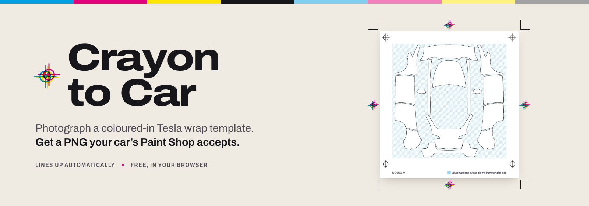
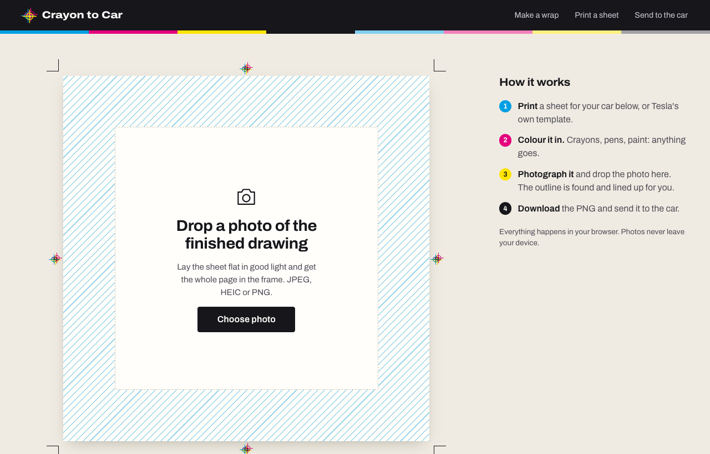
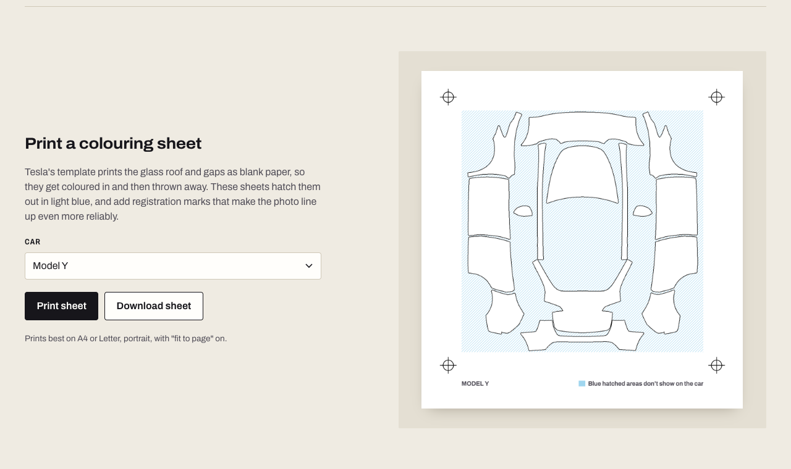
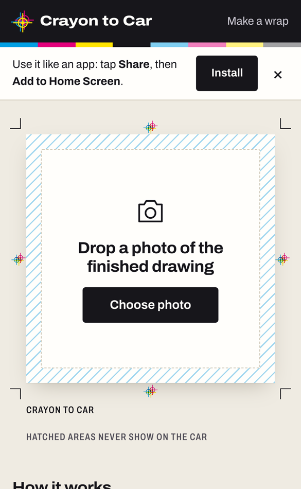

<h1 align="center">
  
</h1>

<b><a href="https://ewels.github.io/tesla-wrap-drawings/">ewels.github.io/tesla-wrap-drawings</a></b>

Kids colour in a printed Tesla wrap template. You take a photo. Crayon to Car finds the template in the photo, lines it up, cuts out the parts that show on the car and saves a PNG for the car's Paint Shop.

1. Print a colouring sheet from the site (or Tesla's own template) and colour it in.
2. Photograph it and drop the photo on the page.
3. Download the PNG, check it on a 3D model of the car, and send it to the car.

Everything runs in the browser. Photos never leave the device.

## Features

- **Automatic alignment.** Works out which car the drawing is for, and copes with rotated, tilted and shadowed photos.
- **Tesla-ready PNG.** Keeps the template's transparency exactly, removes the printed outlines and stays under Tesla's 1 MB limit.
- **3D preview.** See the drawing on the car before you send it.
- **Better colouring sheets.** The glass roof and other parts that never show on the car are hatched out, so nobody spends ages colouring them.
- **Installs on your phone.** Add it to the home screen and it works like an app, offline too.

<table>
  <tr>
    <td width="66%"></td>
    <td width="34%"></td>
  </tr>
</table>

## How the alignment works

- Thin, dark, colourless strokes (the printed outline) are picked out with a black-hat filter, so marker fills and coloured scribbles are ignored.
- A distance transform of those strokes is matched against the official template's outline. The sheet of paper seeds the search, which covers every car model and all four rotations.
- Levenberg–Marquardt then refines a full perspective homography to sub-pixel accuracy.
- The photo is warped into template space, the paper is levelled to white, the printed outlines are painted over, and everything outside the template's panels is made transparent.

The official templates load live from [teslamotors/custom-wraps](https://github.com/teslamotors/custom-wraps). To add a model, add a line to `models.js`.

## 3D preview

The car models in `cars/` are Tesla's in-app visualiser models, converted to Draco-compressed glTF by [tesla-wrap.com](https://www.tesla-wrap.com/). They remain Tesla's property. The wrap is painted onto the material flagged `wrap` in each model, using its second UV set, which matches the template layout. They're shown with [three.js](https://threejs.org/), loaded from jsDelivr only when the 3D view is opened.

## Develop

Static files with no build step. Serve the folder (`python3 -m http.server`) and open it. HEIC photos decode natively in Safari; other browsers load [heic-to](https://github.com/hoppergee/heic-to) from jsDelivr on demand.

Test: `node test/align.test.mjs`

Deploy: enable GitHub Pages from the `main` branch root.

Not affiliated with Tesla.
